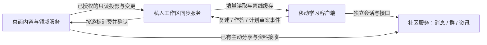

# LogiNote 多端协同架构设计

日期：2026-10-30。阶段：产品方案与可操作原型。

本文描述待实现的方案，不代表私人云同步、Android/iOS 安装包或线上 AI 服务已经可用。本阶段不修改生产后端、不迁移现有私人资料、不自动上传桌面知识库。移动原型中的演示数据和本机保存必须明确标识，不能显示为真实云同步成功。

## 1. 已核实的工程现状

### 桌面数据以本机为权威

- `src/services/storage.ts` 将 Electron 保存委托给原生 IPC；浏览器单独使用 IndexedDB `LogiNoteVaultDB`。不同设备上的 IndexedDB 不互通。
- `src/electron/main.ts`、`src/electron/vaultNoteDelta.ts` 将笔记正文保存到 `vault/notes/*.md`，目录及内容元数据保存到 `vault/metadata.json`；个人状态另存 `user-state/`。增量保存已具备基线检查、串行提交与环境切换保护。
- `src/services/userStateService.ts` 明确区分内容与个人状态。复习、阅读位置、个人认知、模型设置等分布于多种独立文件，不能通过复制单一笔记文件实现完整同步。
- `src/electron/cognitionStore.ts` 保存 `personal-cognition.json`，现有认知修改有 revision 并发检查。浏览器认知库则使用本机 localStorage。
- `cloudSyncEnabled` 目前仅存在于设置类型和默认值，不能据此判定私人知识库已经具有云同步能力。

### 社区服务可以复用，但不等于私人同步服务

- `apps/community-api` 是独立 Node.js/TypeScript/PostgreSQL 服务，现有 `/api/community/v1` 提供账号、私信、群聊、公开内容、资讯等能力。
- 现有网页通过 HttpOnly Cookie 建立社区会话，变更操作校验 Origin、CSRF、幂等键与服务端权限；账号归属不能由浏览器提交的 owner 字段决定。
- `src/electron/communityHost.ts` 和 API `delivery.ts` 已有桌面设备配对、凭据撤销、社区资源接收任务、回执，以及可选学习统计和专注联动。当前桌面分享限制为用户主动选择的单篇只读快照。
- 社区的资源快照、导入副本和 `scope:self` 内容均不应承载完整私人知识库同步。它们的授权、版本及删除语义与私人资料不同。

缺少的能力包括：私人资料库云实体、全局变更游标、跨端离线队列、设备范围授权、删除墓碑、计划跨端冲突处理、移动端原生认证与真机验收。

## 2. 客户端路线与工程边界

建议先建立独立 React 移动 UI，复用无 DOM、无 Electron 依赖的类型和领域逻辑；随后评估通过 Capacitor 生成 Android/iOS 原生容器。Capacitor 支持以 Web 技术开发 iOS、Android 应用并通过插件接入原生能力，参见 [Capacitor 官方文档](https://capacitorjs.com/docs)。这是候选技术路线，尚未安装或验收其原生工程。

移动 UI 不导入桌面 App 根组件、Electron preload、富文本编辑器或场景执行器；不通过缩小桌面侧栏实现适配。建议形成以下边界：

- `apps/mobile-web/`：独立移动导航、阅读、短记录、简测、消息、计划和资讯界面；阶段一可先以独立原型入口验证交互。
- `packages/mobile-contracts/` 或未来通用契约包：私人同步 DTO、事件、分页及错误码，无平台依赖。
- `packages/learning-domain/`：逐步提取已验证的纯函数，避免一次搬迁所有桌面服务。
- 平台适配器：浏览器 IndexedDB，原生持久化与安全凭据存储，桌面文件提交分别实现同一领域接口。不能在手机上模拟 `window.electronAPI`。
- 社区客户端复用现有 API 语义；私人同步使用独立命名空间和存储表。可共用部署、账号体系和基础设施，不共用内容对象或公开授权规则。

浏览器原型可先复用现有 Cookie/BFF 认证。原生版本需要明确 WebView Origin、Cookie 策略、系统登录回调及安全存储；不能假定把网页装入容器后认证自然可用。生产原生凭据不得写入 localStorage、日志或同步事件。

### 参考成熟项目后再确定同步底座

开源方案的调研、官方资料和适配结论集中在 [开源项目参考](./open-source-reference.md)，技术选型以该文档的核实结果及后续验证为准。本文的实体和接口是产品必须满足的语义约束，不要求从零编写网络传输、离线数据库和全部同步引擎。

现有数据是 Markdown 正文加分离的私人状态，移动端又限制长文编辑，因此适合先借鉴 Joplin 风格的对象/变更增量思路：稳定对象标识、可重试同步、删除传播及明确冲突，再为复述/作答追加不可变活动事件。这里指架构思路，不表示直接兼容其同步协议、服务端或插件。

优先验证成熟底座能否承担持久化、离线队列和增量读取；例如调研文档中的 RxDB/PowerSync 候选需要核对许可、部署、原生存储、冲突策略和数据隔离。领域权限、计划 revision、原话留存及桌面文件归档仍由 LogiNote 负责，不能因为引入同步库而省略。

第一版不急于对整库引入 CRDT：当前没有手机与桌面同时逐字编辑长文的需求，CRDT 无法替代权限、业务冲突或计划确认，且需额外解决 Markdown 文件与编辑操作模型的映射。若以后支持真正的多人长文共编，再对独立文档域验证 CRDT；不用它管理设备令牌、作答事实或计划授权。

## 3. 数据流与权威范围

桌面维护长文内容、复杂结构和场景；手机读取其授权投影。复述和作答作为个人活动事件保存，允许桌面离线后继续记录。计划采用服务器分配的领域 revision，任何端的确认提交都必须基于明确的旧 revision。私人云服务持久化已接收事件与投影，并维护同步状态；“云端收到”和“桌面归档完成”是不同状态。

不采用全目录文件同步，不上传完整 `NoteItem[]`，不以最后修改时间胜出覆盖内容。`updatedAt` 仅用于显示和排序，设备时间不能充当版本号、权限依据或去重依据。

## 4. 账号、资料库和设备授权

### 隔离主键

所有私人对象至少归属 `account_id + library_id`；资料库内对象使用稳定 UUID。服务端从已验证会话或设备令牌取得 accountId，再查询该账号对 libraryId 的授权，忽略或拒绝客户端提交的 ownerId、角色及其他账号标识。

第一版仅支持个人 owner，不提供多人共同编辑资料库。社区群成员、联系人、帖子作者和管理员角色均不自动取得私人资料访问权。未来共享资料库需要独立 ACL 与专门授权设计。

同一账号可有多个资料库；每个桌面绑定资料库有稳定 libraryId。更换本机文件路径不生成新云库；复制他人目录或账号切换也不自动认领云库。初次绑定应展示目标账号、资料库及同步范围，再记录明确授权。

### 设备能力

设备授权包含 deviceId、accountId、libraryId、能力集合和 grantVersion，建议拆分 `read_projection`、`append_activity`、`propose_plan`、`commit_plan`。移动端无 `replace_document` 或 `execute_scene` 能力。

撤销授权立即阻止后续读取、写入、任务领取和下载；服务端重新检查令牌状态及 grantVersion。离线设备已有缓存无法由云端保证即时擦除，下次连接时必须锁定并清除相应资料库缓存；用户界面需如实描述这一边界。退出或切换账号应先切断旧请求和队列作用域，再卸载对应缓存视图；旧账号的待发事件不能提交到新账号。

## 5. 移动读取投影白名单

只同步用户授权资料库及范围内的以下字段，按阅读需要分块、分页下行：

- 文档：documentId、标题、noteType、标签、上级 ID、授权后的内部链接、可读正文块、sourceRevision、投影版本、来源引用；长正文只读。
- 阅读资源：经过授权的摘要、引用片段、可读教材块、允许下载的附件清单与短时下载授权。附件另行校验大小、类型和权限，不携带本机路径。
- 计划：planId、目标、阶段、任务稳定 ID、日期、每日时长、完成状态、planRevision；避免靠 Markdown 行号定位跨端任务。
- 简测材料：questionSetId、不可变题目版本、题目、选项及必要引用。正确答案和评分依据按产品策略受控提供，不能将客户端自报正确率当权威评估。
- 个人学习视图：授权的复述历史、个人认知摘要、简测结果和阅读位置；私人表述与客观材料、AI 解释分开显示。

排除模型密钥与 `llm.json`、数据库连接、加密密钥、设备令牌、系统路径、日志、向量库、缓存、Agent 内部历史、场景执行状态与任意文件读取能力。现有 `SHARABLE_NOTE_FIELDS` 是本机内容划分，不是云同步授权清单。

正文投影必须经过受限渲染：不执行脚本、场景包、嵌入代码或任意 HTML；内部链接仅解析到授权对象；外部图片和链接遵循明确加载策略。手机不保存任意长文修改接口，收藏和阅读状态通过独立端点修改。

推荐以本人已同步投影为主，返回 recommendationId、documentId、sourceRevision 与可解释推荐原因，例如“对应今天的计划”“上次简测涉及”。资讯和社区内容应标明其来源，不能混成个人笔记。MVP 可用标签、近期学习和计划规则，不把规则排序表述为 AI 个性化推荐。

离线搜索只覆盖已缓存资料，界面明确展示“离线·搜索已下载内容”、缓存范围和最近服务端确认状态。无结果不等于桌面库没有该内容。未缓存正文展示待下载状态，不以演示内容补齐。

## 6. 核心实体与事件

以下是设计契约，不是已存在的数据库表：

- `PrivateLibrary`：libraryId、accountId、displayName、schemaVersion、syncEpoch、状态。syncEpoch 用于识别完整重建，旧游标不能误用。
- `DeviceGrant`：deviceId、libraryId、能力、grantVersion、revokedAt、lastSeenAt。
- `DocumentProjection`：documentId、sourceRevision、projectionRevision、正文块及来源；revision 由权威服务分配并持久化，不使用客户端时间戳。
- `ActivityEvent`：eventId、deviceId、libraryId、kind、payloadVersion、payload、clientRecordedAt、serverAcceptedAt、serverPosition、ingestionState。客户端时间仅记录用户情境。
- `Plan` / `PlanDraft`：planId、planRevision、draftId、basePlanRevision、生成约束、可审阅 diff、草案状态。
- `ReadingPosition`：documentId、sourceRevision、deviceId、blockAnchor、段内偏移、positionRevision、serverPosition。
- `ChangeEntry`：syncEpoch、serverPosition、entityType、entityId、entityRevision、operation、投影或墓碑；游标对客户端不透明。
- `IngestionReceipt`：eventId、云接收位置、桌面消费状态、归档对象 ID、可重试错误码。接收回执不代表学习效果已评分。
- `AiJob`：jobId、owner/library、能力需求、输入实体与 revision、状态、租约、尝试次数、结果或错误，禁止接受任意系统命令。

### 复述与个人认知

复述使用 `restatement.recorded` 事件，包含稳定 eventId、原文、关联 documentId/sourceRevision、记录方式及可选录音附件引用。重复发送同一事件不得重复入库。保存原话与后续 AI 分析分别拥有 ID、来源与版本；AI 不能静默改写用户原话。更正和撤回追加新事件指向原 eventId，保留历史语义；移动端显示撤回后内容不再参与当前推荐/检索。

桌面消费已接受事件时，经认知和复述领域服务入库，不直接覆盖 `personal-cognition.json`。需要映射到已有 `CognitionFile.revision` 时，应读取当前 revision 并执行领域变更，冲突时重建变更或保留待处理事件。用户尚未确认的 AI 提炼不得自动变成已确认认知。

### 简测

`quiz.attempt.submitted` 包含 attemptId、questionSetId/version、每题 questionId 与用户答案、来源 revision 和可选耗时；按 attemptId 去重。交卷先持久化到本地 outbox，再提交云端。离线时可以对已下载、允许本地判分的客观题给出“本机即时反馈”；主观题标记待评价。

服务器/桌面重新验证题目版本并产生 `quiz.attempt.evaluated`，保持作答与评价分离。题源已删除或题目过期时保存作答事实并标记无法评价，不能丢弃作答或凭空判对。桌面归档复用现有 quickCheck 写入与回执语义；一次重试仍属于原 attempt。

## 7. 计划生成、调整与冲突

手机输入目标、可用时长、期限及调整意图；AI 返回 PlanDraft，不直接改正式计划。草案展示任务增删、日期变化、工作量及调整理由。用户明确确认时提交 basePlanRevision 与稳定幂等键，服务器在同一事务内比较版本并应用变更、递增 planRevision、记录变更日志。

若桌面已经修改计划，返回 `409 plan_revision_conflict`，保留草案并展示当前版本；允许用户重新生成或重放仍适用的调整。不能以较晚时间戳、整份 JSON 或 Markdown 全文覆盖。草案生成期间源目标或时间约束变化也需要重新校验。

任务完成使用稳定 taskId 及任务状态版本，幂等提交；调整草案不能通过改变任务序号误完成别的任务。MVP 桌面与云端尚未形成共同计划权威前，只允许移动端保存草案/调整意图，明确“等待桌面处理”，不宣称计划已同步生效。

## 8. 同步协议、离线和恢复

### 读取

首次同步取得授权范围快照和同一一致性点的 snapshotCursor；随后从该游标拉取 ChangeEntry，按服务端位置排序并原子写入本地缓存。分页游标必须由服务器生成且绑定账号、资料库与 syncEpoch。中断后从最后已提交游标继续，不能先推进游标再写数据。

增量游标过期返回 `410 cursor_expired`，执行保留 outbox 的重新拉取；不清除未提交私人记录。变更数据与变更日志在同一事务提交，避免状态已改变但游标不可见。

### 写入 outbox

本地事务同时保存用户记录和 outbox 条目。条目固定绑定 accountId、libraryId、deviceId、eventId、payloadVersion，状态区分 `pending`、`sending`、`cloud_accepted`、`desktop_archived`、`retryable_error`、`needs_action`。界面分别显示“已保存到本机”“云端已收到”“桌面已归档”。

网络错误、5xx、限流按受控指数退避重试并遵循 Retry-After，仍使用原 eventId/幂等键。401 暂停等待重新登录；403/revoked 锁定作用域，不改投其他账号；409 显示冲突；400/schema 错误进入可恢复人工处理，不无限循环。应用重启恢复发送租约，不将 `sending` 永久视作成功。

服务端幂等唯一约束至少包括 accountId、libraryId、operation、idempotencyKey；同键同 payload 返回原结果，同键不同 payload 返回冲突。检查权限、写业务对象、分配 serverPosition 和保存幂等结果需在一致事务内完成。HTTP 超时不能证明写入失败。

### 删除、墓碑和撤销

文档删除产生携带 entityRevision 的墓碑，使离线设备删除旧投影、搜索索引和附件引用；本地离线旧副本不能重新上传复活长文。服务器保留墓碑直到约定设备确认和保留窗口完成；长期离线设备需要重做快照。删除源材料不默认删除用户独立复述原话，但断开可读引用并标记原文已不可用。

设备撤销不等待普通同步游标；所有敏感请求实时检查授权。取消同步与删除云数据是不同操作，应分别呈现范围和结果。错误恢复不能通过自动重建空库覆盖既有内容。

### 阅读位置

阅读位置不改文档 sourceRevision。位置绑定 sourceRevision 与稳定 blockAnchor，scrollTop 仅作同设备显示兜底；不同屏幕不能直接复用像素位置。保存设备自己的位置序列，并提供服务端确认的最近位置供用户“继续阅读”，不自动让另一台设备跳页。

文档版本变化时验证锚点是否仍存在，否则回到章节或顶部并提示内容更新。顺序与并发基于服务端位置/positionRevision，而不是 lastReadAt。现有桌面阅读状态中的时间戳比较只属于本地兼容逻辑，不能直接作为跨设备协议。

## 9. AI 任务与桌面离线

读取、搜索已缓存资料、记录复述、完成已下载简测、查看计划不要求桌面在线。AI 能力分为两类：

- 经用户配置和授权的云端模型任务：服务端持有模型凭据，依据授权投影处理；移动端只提交任务需求，不取得桌面 API Key。未配置时清楚显示 AI 服务未接入。
- 依赖桌面本地模型、私有索引或完整资料的任务：创建等待桌面的 AiJob，显示排队原因。桌面上线后按租约领取，执行前复查账号、资料库、源 revision、取消状态和预算。移动端可取消，过期输入需要重新确认，不能返回旧计划覆盖新计划。

任务状态建议为 `queued`、`waiting_for_desktop`、`running`、`succeeded`、`failed`、`cancelled`、`needs_review`。草案生成成功只代表有可审阅结果。失败保留原始输入和手动记录；不伪造 AI 回复、不把等待桌面显示为正在生成。

语音录入先解决本机文字记录闭环；录音、转写与后台任务权限独立申请。未接入录音或转写时不显示虚假的录制进度。手机系统后台限制意味着不能依赖常驻 WebView 持续同步，前台恢复和手动重试必须可完成工作。

## 10. 拟议 API

以下 `/api/private/v1` 路径仅是设计接口，不应由原型直接调用不存在的后端：

- `GET /libraries`：列出当前账号自己的资料库，返回能力与同步状态。
- `POST /libraries/:libraryId/devices`：创建当前账号授权设备，记录能力；账号来源由服务端确定。
- `DELETE /libraries/:libraryId/devices/:deviceId`：撤销设备，立即失效；私有令牌不返回给其他设备。
- `GET /libraries/:libraryId/snapshot?cursor=...`：按一致性点分页返回白名单投影、snapshotCursor/syncEpoch。
- `GET /libraries/:libraryId/changes?cursor=...&limit=...`：返回有界增量、nextCursor、hasMore；无权对象不得出现在分页或总数中。
- `GET /libraries/:libraryId/documents/:documentId`：读取当前授权投影和 sourceRevision，不接受任意文件路径。
- `GET /libraries/:libraryId/search?q=...&cursor=...`：在授权资料内搜索；服务端检索与本机离线检索明确区分。
- `POST /libraries/:libraryId/events`：有界批次提交复述/作答，逐项返回云接收回执；每项独立 eventId，部分失败可逐项重试。
- `GET /libraries/:libraryId/receipts?cursor=...`：读取桌面归档及评价状态；不由客户端自报成功。
- `PUT /libraries/:libraryId/reading-positions/:documentId`：传 sourceRevision、deviceSequence、blockAnchor；不写长文。
- `POST /libraries/:libraryId/plan-drafts`：创建生成/调整任务，传 basePlanRevision 与目标约束。
- `POST /libraries/:libraryId/plan-drafts/:draftId/commit`：用户审阅后确认，传 basePlanRevision，版本冲突返回 409。
- `POST /libraries/:libraryId/ai-jobs`、`GET /libraries/:libraryId/ai-jobs/:jobId`、`POST /libraries/:libraryId/ai-jobs/:jobId/cancel`：创建、查看和取消有界领域任务。

修改接口沿用身份验证、Origin/CSRF 或正式原生授权方案、幂等及速率限制；设备专用接口需要明确允许的客户端与能力。所有列表有上限、分页与 payload 大小限制，日志仅保留必要元信息，错误响应不得泄露私人正文或其他账号对象是否存在。原生授权与 Web CSRF 不能未经设计混用。

## 11. MVP 分阶段验收

### 阶段一：本次方案与原型

交付独立移动导航与可操作流程：推荐阅读/搜索、短复述、简测、计划草案、消息和资讯入口。演示、离线、本机保存和未来云能力明确区分；无需上传真实数据。原型不能暗中读取桌面完整库、发送社区消息或调用付费模型。

验收：窄屏无横向溢出；底部导航及输入不被安全区/键盘遮挡；能完成一次查阅→复述/简测→保存流程；计划确认与冲突状态可理解；刷新后本机记录可恢复；未接入能力不显示成功回执。

### 阶段二：私人只读同步

交付资料库授权、设备管理、桌面白名单投影、云端快照/增量、移动缓存、离线搜索和阅读位置。

验收：甲账号无法枚举或读取乙账号资料；同账号资料库不串库；断网/重启/分页中断不丢游标；文档更新、删除与旧游标重置正确；撤销后新请求被拒；不上传密钥与排除字段；桌面关闭后仍能读已同步材料。

### 阶段三：活动双向归档与计划

交付复述/简测事件 outbox、云端回执、桌面幂等归档、计划草案审阅与 revision 提交。

验收：重复点击、网络超时和多次重启均不产生重复复述/作答；云已收与桌面已归档分别可见；源题删除仍保留作答；两端同时改计划必然产生可处理冲突，不覆盖长文；切换账号不重放旧队列；桌面离线 AI 请求排队、取消和过期行为可验证。

### 阶段四：Android/iOS 真机与发布准备

验证原生认证、安全凭据存储、持久化容量、权限、深链、键盘、前后台恢复、离线失败恢复及低性能设备阅读。签名、构建、商店资料和审核需要正式开发环境与账号；不能用浏览器通过替代真机或商店验收。

## 12. 风险与尚未实现项

- 本阶段没有新增私人云 API、数据库表或桌面同步 worker，没有完成真实跨设备互通。
- 未生成 Android APK/AAB 或 iOS IPA，未配置签名、开发者账号、推送和真机麦克风/转写。
- Capacitor 与具体版本、插件及原生认证仍需技术验证；iOS 构建和发布环境单独准备。
- 数据首次绑定、资料库标识迁移、源文件外部修改与云端 revision 映射需要专门测试；现有本机增量协议不可直接对公网暴露。
- 私人云存储、附件带宽、检索、AI 调用会带来成本；上线前设置可解释额度、留存和失败策略，不承诺永久免费。
- 若需端到端加密，必须设计密钥恢复、多设备分发与撤销，并重新评估服务端搜索/AI；当前方案没有实现或宣称端到端加密。
- 设备已下载的离线缓存与录音存在本机数据生命周期问题；撤销无法保证离线设备即时擦除。
- 私人内容上云范围、删除保留窗口和 AI 提交范围应在真实启用时由用户可审阅配置，不能从开启社区账号推导授权。

参考：[Capacitor 官方文档](https://capacitorjs.com/docs)；本仓库 `apps/community-api/README.md`、`src/services/storage.ts`、`src/services/userStateService.ts`、`src/electron/vaultNoteDelta.ts`、`src/electron/communityHost.ts`、`src/services/cognition/store.ts` 与 `src/services/textbook/readingState.ts`。
